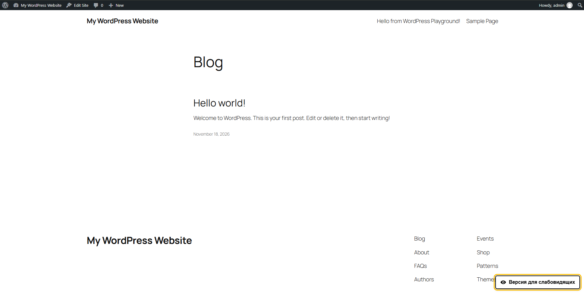
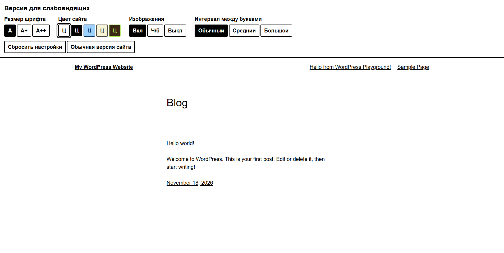
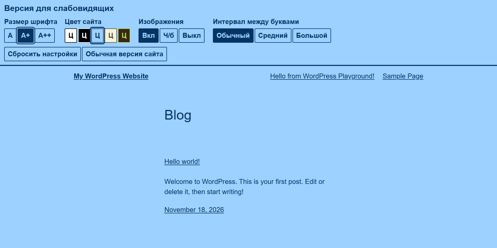

BVI Accessibility — версия сайта для слабовидящих (WordPress)

Лёгкий плагин для WordPress, который добавляет на сайт переключатель **версии для слабовидящих**: крупный шрифт, контрастные цветовые схемы, управление изображениями и интервалом между буквами. Настройки запоминаются, плагин не требует настройки и не подключает внешние сервисы.

Плагин создан как учебный и демонстрационный проект по теме веб-доступности (ГОСТ Р 52872-2019, WCAG).

Скриншоты

| Обычная версия | Версия для слабовидящих | Синяя схема, шрифт A++ |
|---|---|---|
|  |  |  |

Возможности

- **Размер шрифта:** три ступени (A, A+, A++).
- **Цветовые схемы:** чёрное на белом, белое на чёрном, тёмно-синее на голубом, коричневое на бежевом, зелёное на тёмно-коричневом.
- **Изображения:** оставить, сделать чёрно-белыми или выключить с заменой на alt-текст.
- **Интервал между буквами:** обычный, средний, большой.
- **Сброс настроек** и возврат к обычной версии сайта одной кнопкой.
- **Сохранение выбора в cookie** на 1 год. Ранний скрипт в `<head>` применяет настройки до отрисовки, поэтому страница не «мигает».
- **Доступная панель управления:** все элементы — нативные кнопки, работают с клавиатуры, у кнопок есть `aria-label` и `aria-pressed`, панель получает фокус при включении режима.
- В режиме отключаются анимации и фоновые изображения, ссылки подчёркиваются, у элементов в фокусе виден контур.

Установка

1. Скачайте архив `bvi-accessibility.zip` (или соберите его из папки `bvi-accessibility`).
2. В админке WordPress откройте **Плагины → Добавить новый → Загрузить плагин**.
3. Выберите архив, нажмите **Установить**, затем **Активировать**.
4. На сайте появится кнопка **«Версия для слабовидящих»** в правом нижнем углу.

Требования: WordPress 5.2+, PHP 7.2+.

Использование

Кнопка в шапке сайта (рекомендуется)

Для сайтов, где ссылка на версию для слабовидящих должна быть видна сразу, вынесите кнопку в шапку, а плавающую отключите.

Вариант 1 — шорткод:

```
[bvi_button text="Версия для слабовидящих"]
```

Вариант 2 — пункт меню:** добавьте в меню пункт «Произвольная ссылка» с адресом `#` и CSS-классом `bvi-toggle`.

Отключить плавающую кнопку** (в `functions.php` темы или в своём плагине):

```php
add_filter( 'bvia_floating_button', '__return_false' );
```

Любой элемент с классом `bvi-toggle` включает режим для слабовидящих по клику.

 Как это работает

- PHP-часть подключает стили и скрипт, добавляет ранний скрипт в `<head>` и шорткод.
- JavaScript строит панель настроек, переключает CSS-классы на `<html>` (`bvi-on`, `bvi-fs-*`, `bvi-cs-*`, `bvi-ls-*`, `bvi-img-*`) и сохраняет выбор в cookie `bvi_settings`.
- CSS задаёт цвета и размеры через переменные и переопределяет оформление темы только внутри режима `bvi-on`.
- Значения из cookie проверяются по белому списку, произвольные данные в классы не попадают.

```
bvi-accessibility/
├── bvi-accessibility.php   # плагин: подключение файлов, шорткод, ранний скрипт
└── assets/
    ├── bvi.css             # стили режима и панели
    └── bvi.js              # панель, состояние, cookie
```

Ограничения

- Плагин покрывает **переключатель версии для слабовидящих**, а не весь ГОСТ Р 52872-2019 и не требования приказа Минздрава № 956н к содержанию сайта клиники. Заголовки, alt-тексты, подписи полей форм, структура и документы проверяются отдельно.
- Иконки, нарисованные как фоновые изображения или встроенные SVG, на тёмных схемах могут потребовать дополнительных CSS-правил под конкретную тему.
- Изображения, подгруженные динамически после включения режима, останутся видимыми до обновления страницы.
- Нестандартная вёрстка отдельных тем (слайдеры, оверлеи, липкие блоки) может требовать доработки.
- Плагин использует служебную cookie. Упомяните её в политике cookie или конфиденциальности сайта.
- Плагин не является юридической гарантией соответствия требованиям. Итоговую проверку лучше проводить вместе с юристом и проверкой экранным диктором (например, NVDA).

Проверка

Рекомендуемый порядок проверки после установки:

- пройти сайт клавишей Tab: фокус виден, панель доступна;
- проверить все размеры шрифта и цветовые схемы;
- проверить отключение изображений и сохранение настроек после перезагрузки страницы;
- прогнать сайт через Lighthouse, WAVE или axe DevTools;
- проверить работу с экранным диктором.

Плагин проверялся в WordPress Playground со стандартной блочной темой.

Лицензия

GPL-2.0-or-later. Свободное использование, изменение и распространение с сохранением лицензии.

Автор

feylung — https://github.com/atrava1
